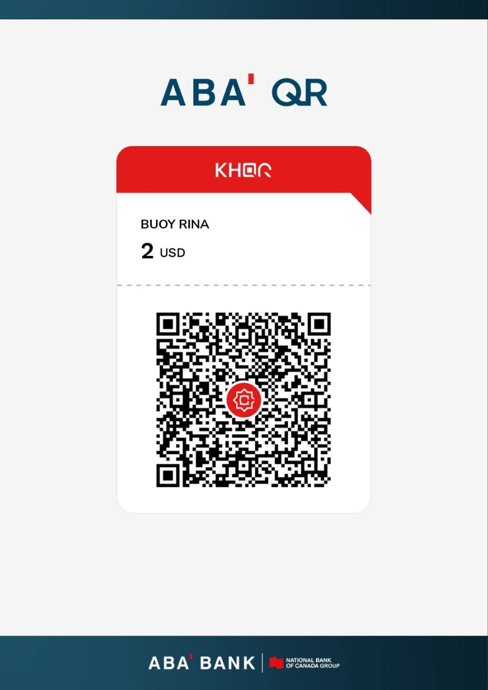
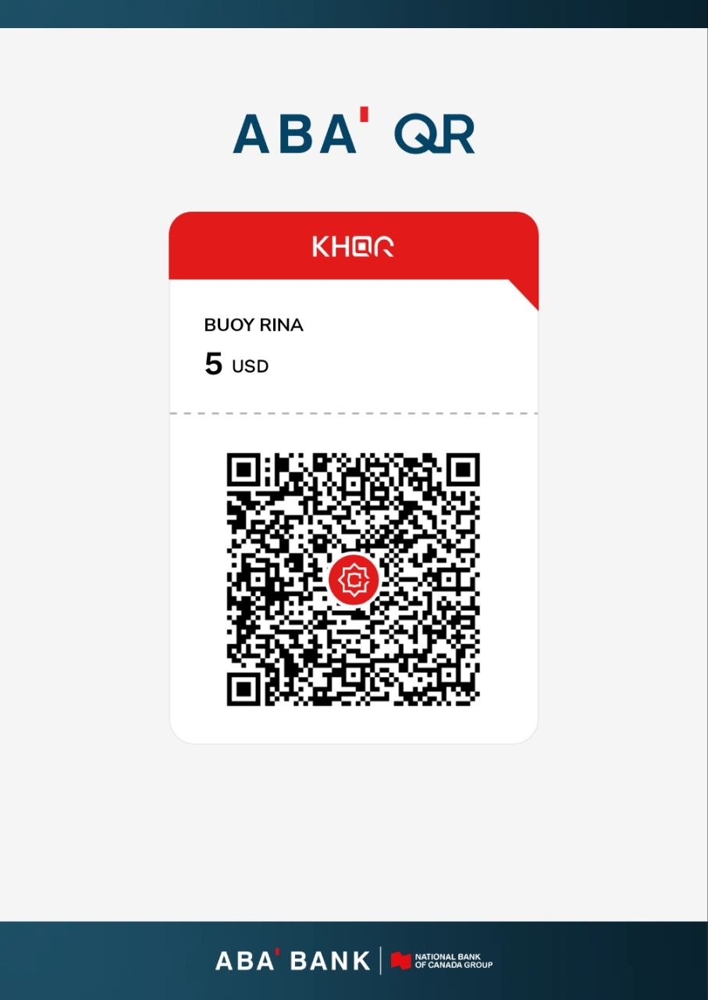
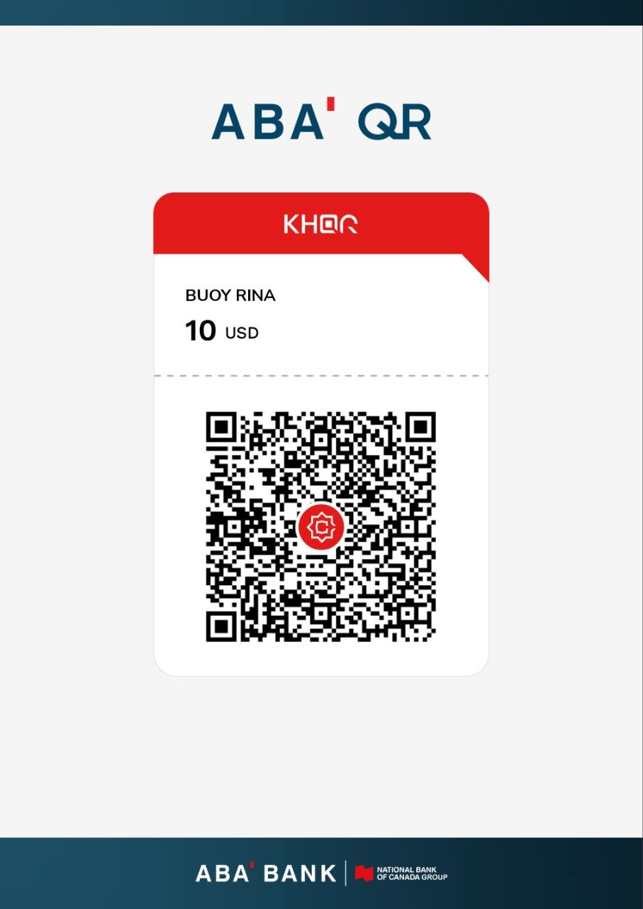

# No-code AI for Young Cambodian Learners

By **Rina Buoy, PhD**

## About the book
*No-code AI for Young Cambodian Learners* is a hands-on guide for secondary and high school learners (Grades 7–12) who want to build real AI without writing code. Based on the *Build Your Own AI* course, it uses Google Teachable Machine to train image, sound and pose classifiers, and teaches the ideas behind them: learning from examples, collecting varied data, training and tuning, testing with new data, and using AI responsibly. Examples include Khmer and English handwritten digits and other local uses.

Each chapter has learning objectives, key terms, step-by-step activities, a summary and questions to check understanding. Optional appendices explain pixels, sound and spectrograms, how a model learns, pre-trained models and how to measure results, for interested readers.

This book was prepared with the assistance of Claude Code (an AI tool from Anthropic). The author provides the content and reviews and revises all of the outputs.

**Status:** draft. Only reviewed chapters are published here.

## Plan
By the **end of 2026** the goal is a complete, fully reviewed edition of the book:
- a **soft copy (PDF), free to distribute**, and
- a **low-cost hard copy** (budget print edition).

Chapters are published here as the author reviews them.

## Download the PDFs

| PDF | Contents | Download |
|---|---|---|
| **Book so far** | Cover, Chapters 1–3, Appendices A–E, About the Author (42 pages) | [Download](https://github.com/rinabuoy/no-code-ai-cambodian-learners/raw/main/book/public/main.pdf) · [View](https://github.com/rinabuoy/no-code-ai-cambodian-learners/blob/main/book/public/main.pdf) |
| Chapter 1 | What Is AI, Really? | [Download](https://github.com/rinabuoy/no-code-ai-cambodian-learners/raw/main/book/public/chapter-1.pdf) · [View](https://github.com/rinabuoy/no-code-ai-cambodian-learners/blob/main/book/public/chapter-1.pdf) |
| Chapter 2 | Image Classification | [Download](https://github.com/rinabuoy/no-code-ai-cambodian-learners/raw/main/book/public/chapter-2.pdf) · [View](https://github.com/rinabuoy/no-code-ai-cambodian-learners/blob/main/book/public/chapter-2.pdf) |
| Chapter 3 | Image Classification Project Lab: Train, Tune, Save and Share | [Download](https://github.com/rinabuoy/no-code-ai-cambodian-learners/raw/main/book/public/chapter-3.pdf) · [View](https://github.com/rinabuoy/no-code-ai-cambodian-learners/blob/main/book/public/chapter-3.pdf) |
| Chapter 4 | Audio and Sound Classification | Not yet published |
| Chapter 5 | Audio Classification in Practice: Use Cases, Data and Evaluation | Not yet published |
| Chapter 6 | Pose Prediction: Build a Sleepy-Head Detector | Not yet published |
| Chapter 7 | Teaching AI to Read Digits in Khmer and English | Not yet published |
| Chapter 8 | Image Data Augmentation: More Training Pictures from the Photos You Have | Not yet published |
| Chapter 9 | Audio Data Augmentation: More Training Sounds from the Clips You Have | Not yet published |

## Support this work
If this book is useful to you, you can help fund the free soft copy and the low-cost hard copy by donating **$2, $5 or $10** with ABA / KHQR. Open your banking app and scan a code:

<table>
  <tr>
    <td align="center"><b>$2</b> </td>
    <td align="center"><b>$5</b> </td>
    <td align="center"><b>$10</b> </td>
  </tr>
</table>

Thank you for your support.
