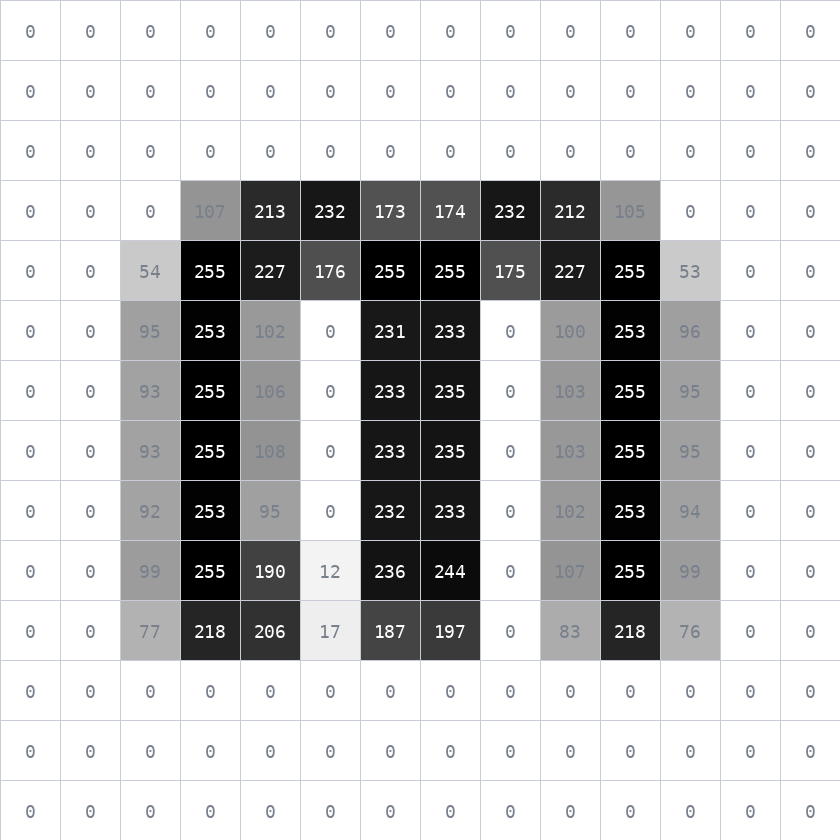

# Appendix A. How Computers See Pictures

> **For curious readers.** You do not need this appendix to finish the course. It explains, step by step, what Chapters 2 and 7 mean when they say "a picture is a grid of numbers".

## A.1 A picture is a grid
Look closely at a photo on a screen and you would find tiny squares called **pixels** (short for "picture elements"). Each pixel is one dot of one colour. Put thousands of them in rows and columns and your eyes see a smooth picture.

## A.2 Pixels are numbers
A computer cannot "look". It stores a number for each pixel.

- In a **grayscale** picture, one number per pixel says how dark it is. In Chapter 7, 0 means blank paper and 255 means the darkest ink.
- In an **RGB** (colour) picture, each pixel has **three** numbers: how much **R**ed, **G**reen and **B**lue light to mix. Mixing the three gives any colour.
- In a **binary** picture, each pixel is only one of two values, black or white.

Figure @fig:pixel-grid-km3-2 shows how a digit looks as a grid of numbers.

{w=0.5}

Here is a tiny example: a 5 × 5 grayscale picture of the letter **L**. The dark strokes have big numbers and the empty paper has zeros.

| | col 1 | col 2 | col 3 | col 4 | col 5 |
|---|---|---|---|---|---|
| **row 1** | 255 | 0 | 0 | 0 | 0 |
| **row 2** | 255 | 0 | 0 | 0 | 0 |
| **row 3** | 255 | 0 | 0 | 0 | 0 |
| **row 4** | 255 | 0 | 0 | 0 | 0 |
| **row 5** | 255 | 255 | 255 | 255 | 255 |

*Author's example, made up to illustrate the idea.* If you squint at the table, the 255s draw the letter. That is all the computer has to work with.

## A.3 How many numbers is a photo?
Teachable Machine resizes every camera frame to **224 × 224** pixels (Chapter 7). A colour frame has three numbers per pixel, so one picture is 224 × 224 × 3 = **150,528 numbers**. *(The multiplication is the author's arithmetic from the figures in Chapter 7.)* A bigger picture holds more detail but means more numbers to process, which is why the tool shrinks every frame to the same size before the model sees it.

## A.4 Why this matters for your projects
- **The model never "sees" a three, a smile or a bottle.** It only sees patterns in numbers and learns which patterns usually go with which label.
- **Varied samples matter.** The same digit written thicker, tilted or in different light produces very different numbers. That is why Chapters 2, 7 and 8 ask for varied samples and why augmentation helps.
- **Light and background change the numbers too.** The same object in a dark room and in a bright room gives two different grids.

## A.5 Try it
1. Draw a 5 × 5 grid on paper and shade squares to make a letter. Write the number for each square (0 or 255) and swap with a friend. Can they guess your letter from the numbers alone?
2. Open any photo on your computer and zoom in until you can see the squares. Roughly how many pixels wide is a thin line?
