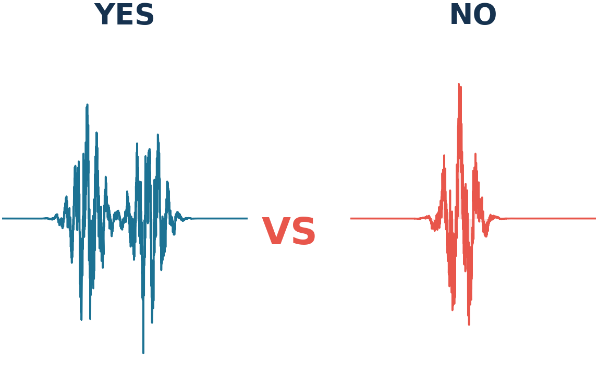
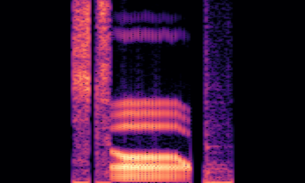

# Appendix B. Sound, Waves and Spectrograms

> **For curious readers.** Chapters 4, 5 and 9 use the word *spectrogram*. This appendix explains where it comes from. You can finish the course without it.

## B.1 What is sound?
Sound is a **vibration of the air**. When you speak, your vocal cords open and close hundreds of times a second (Chapter 4), pushing the air back and forth. The moving air reaches a microphone, which turns the movement into an electric signal.

## B.2 Reading a waveform
The picture a recorder draws is called a **waveform**: time goes left to right and the height shows how strong the vibration is at that moment.

- **Loudness** (volume) is the *height* of the wave: a loud sound makes tall peaks.
- **Pitch** (how high or low a sound is) depends on how *fast* the wave repeats: a high note vibrates fast and a low note vibrates slowly. The number of repeats per second is the **frequency**, measured in hertz (Hz).

Figure @fig:audio-yes-vs-no-2 shows how the waveforms of "Yes" and "No" differ.

{w=0.65}

## B.3 From sound to numbers
A computer measures the signal many times every second and stores each measurement as a number. Each measurement is a **sample**, and the number of samples per second is the **sample rate**. *(General background, not from the lessons: music CDs use 44,100 samples per second.)* A higher sample rate gives a more detailed recording and a bigger file. This is why file formats and clip length matter (Chapter 4).

## B.4 Why a waveform is not enough
A waveform shows *how loud* the sound is over time, but a word is made of many pitches mixed together. Two different words can have similar loudness patterns. To tell them apart, it helps to see **which pitches are present at each moment**.

## B.5 The spectrogram
A **spectrogram** is a picture of sound (as defined in Chapter 9):

- **left to right** is time,
- **bottom to top** goes from low pitch to high pitch,
- **brightness** shows how loud that pitch is at that moment.

*Author's explanation of how it is made:* the computer takes a very short slice of the sound, works out how much of each pitch is in it, and draws that as one thin vertical stripe. Putting the stripes side by side gives the picture.

Figure @fig:spectrogram-original-2 shows the spectrogram of the word "stop".

{w=0.4}

## B.6 Why spectrograms help AI
Once sound is a picture, a model that is good with pictures can learn from it. This is why audio classification in Teachable Machine is treated much like image classification: the word "yes" makes one kind of pattern and "no" makes another. It is also why **masking** (Chapter 9) works: blanking a vertical band hides one moment and blanking a horizontal band hides a range of pitches, so the model cannot depend on one small detail.

## B.7 Try it
1. Use the course's Sound Wave Recorder (Chapter 5) to record "yes" in a low voice and then in a high voice. How does the waveform change?
2. Whistle a rising note. In which direction does the bright line move on a spectrogram?
3. Clap once. Is the picture a short stripe or a long band? Why?
