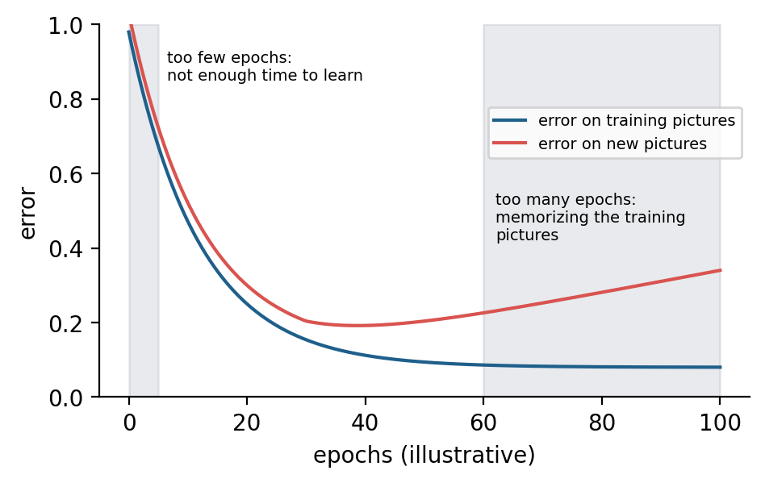

# Appendix C. How a Model Learns

> **For curious readers.** Chapter 3 introduces epochs, learning rate and batch size without explaining the machinery. This appendix gives a gentle picture of what happens when you press **Train Model**. It is simplified on purpose and is the author's explanation, not taken from the slides.

## C.1 Learning by guessing and correcting
Training is a loop of four steps:

1. **Guess.** The model looks at a training sample and guesses a label.
2. **Compare.** It checks the guess against the label you gave.
3. **Measure the mistake.** The size of the mistake is a number called the **loss**: a big loss means a bad guess.
4. **Adjust.** The model changes its inner settings a tiny bit so the same guess would be less wrong next time.

Then it repeats with the next samples, thousands of times.

## C.2 What gets adjusted?
Inside the model are many numbers called **weights**. Each weight says how much attention to pay to one clue, such as an edge or a curve. Training nudges the weights up or down. You never touch them; Teachable Machine does it for you.

## C.3 The three settings
**Epochs.** One epoch is one full pass through all your samples. More epochs give the model more chances to improve, but too many can make it memorise.

**Batch size.** Instead of adjusting after every single sample, the model looks at a small group (a **batch**) and adjusts once for the group. With the default batch size of 16 and 160 samples, one epoch has 10 adjustment steps (160 ÷ 16).

**Learning rate.** The learning rate sets how big each adjustment is. Imagine walking down a hill in fog to reach the valley, where the loss is smallest:

- Very **small** steps get you there, but very slowly.
- Very **large** steps make you jump over the valley again and again.
- A medium step, like the default **0.001**, usually works well.

## C.4 Accuracy and error: right or wrong?
Before we talk about learning curves, we need two simple words. Both describe the same thing from opposite sides: *did the model get the picture right or wrong?*

- **Accuracy** is how often the model is **right**. If you show it 10 pictures and it names 8 of them correctly, its accuracy is 8 out of 10, or **80%**.
- **Error** is how often the model is **wrong**. In the same test it named 2 pictures wrongly, so its error is 2 out of 10, or **20%**.

Accuracy and error always add up to 100%, so a high accuracy means a low error:

accuracy + error = 100%

*Everyday example:* a quiz with 10 questions. Eight right answers is an 80% score (accuracy) and two wrong answers is 20% error.

For a picture model, "right" means the model's label matches the real label. Show a photo of a banana. If the model says "banana", that is a correct prediction; if it says "apple", that is a wrong one, and it counts toward the error. *(The terms "loss" in C.1 and "error" here are closely related: the loss is a more detailed way of measuring how wrong the guesses are, and training tries to make both smaller. This link is the author's simplification.)*

During training the model keeps trying to **reduce its error and raise its accuracy**. Chapter 3 shows this on a chart, and the next section explains why the curve eventually flattens. One more point, which matters in the rest of this appendix: there are two kinds of error.

- **Training error:** mistakes on the pictures the model learned from.
- **Error on new pictures:** mistakes on pictures it has never seen. This is the one that matters in real life.

## C.5 Why accuracy levels off
When training works, the error falls quickly at first and then flattens (and accuracy rises and flattens), because the easy mistakes are fixed first. More epochs after that help little and can hurt.

Figure @fig:epochs-effect-2 illustrates the idea with example curves.

{w=0.8}

## C.6 Overfitting and underfitting
- **Underfitting:** the model has not learned enough yet. It does badly even on its own training samples.
- **Overfitting:** the model has memorised the training samples, like a student who learned last year's answers but cannot solve new questions. It does very well on training samples and poorly on new ones.

This is why the course always tests with **new** samples (Chapters 3, 7 and 9), and why varied data and augmentation (Chapters 8 and 9) help: a model that has seen many variations has less to memorise.

## C.7 What is a neural network?
Teachable Machine models are built from layers of simple units that pass numbers forward, loosely inspired by brain cells. Early layers pick out simple clues such as edges, curves or pitches; later layers combine them into bigger ideas such as a loop, an eye or a word. *(General background, not from the lessons.)* You do not design any of this. A ready-made model supplies most of it (see Appendix D).

## C.8 Try it
1. Train the same model with 5, 20 and 50 epochs. Write down the accuracy each time. When does adding epochs stop helping?
2. Change only the learning rate, first very small, then very large. What happens to the accuracy?
3. A model is tested on 20 new pictures and names 17 correctly. What are its accuracy and its error?
4. In your own words, why is memorising a bad way to learn?
