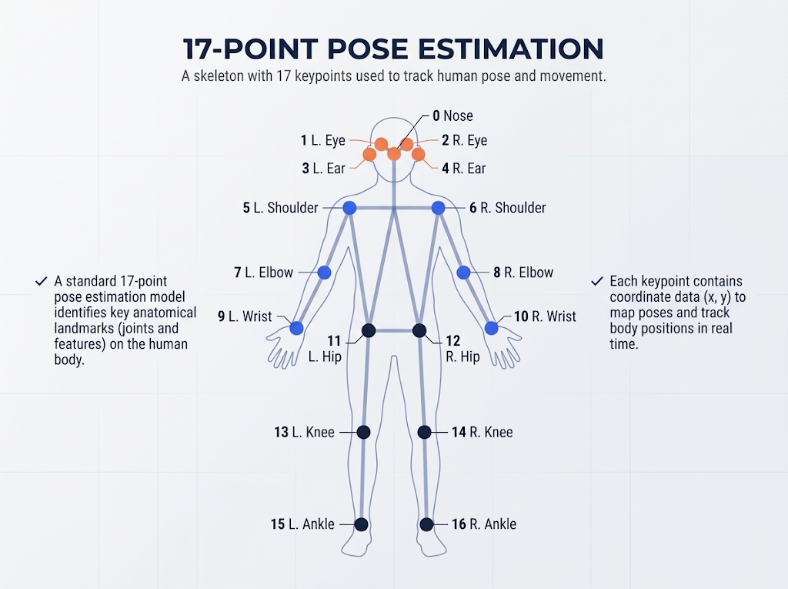

# Appendix D. Pre-trained Models and Keypoints

> **For curious readers.** Chapters 6 and 7 mention MobileNet, PoseNet and "17 keypoints". This appendix explains these ideas in more detail.

## D.1 Why you need so few samples
Training a picture model from nothing would need a huge number of pictures and powerful computers. Teachable Machine avoids this with **transfer learning**:

1. A large model, such as **MobileNet** for pictures, is first trained on a very large collection of images. It learns general clues: edges, curves, textures and shapes.
2. Teachable Machine keeps that model and adds a small new part on top: **your classifier**.
3. Only your classifier is trained, with your samples. It learns which ready-made clues mean *your* classes.

That is why about 30–50 samples per class is enough to start (Chapters 6 and 7). *Author's analogy:* it is like learning a new alphabet when you already know how to read. You are not starting from zero.

Figure @fig:mobilenet-pipeline-2 shows the transfer-learning pipeline for digits.

## D.2 Who does what
- **MobileNet** is the pre-trained picture model behind Image projects.
- **PoseNet** is the pre-trained body-position model behind Pose projects.
- **Your classifier** is the small part that belongs to you. It is the only part that changes when you train.

A borrowed model is only as good as what it already knows. PoseNet knows bodies, so it cannot tell an apple from a mango.

## D.3 What is a keypoint?
A **keypoint** is a named point on the body, such as the nose, left shoulder or right knee. PoseNet finds **17 keypoints** (Chapter 6): five on the face, six on the arms and six on the hips and legs.

Figure @fig:pose-17-keypoints-2 shows the 17 keypoints on the body.

{w=0.55}

Each keypoint is stored as a pair of numbers **(x, y)**, its position in the picture. So a pose is a list of 17 pairs of numbers.

## D.4 Why poses are easier than pictures
A camera frame has more than 150,000 numbers (Appendix A). A pose has only 17 × 2 = **34 numbers**. The classifier has far less to sort through, and it ignores your clothes, the wall and the light. It only asks: *where are the body parts?* This is why a head tilt is easy to detect in Chapter 6: the two ear points are no longer level. *(Arithmetic and explanation are the author's.)*

## D.5 Where pose models can go wrong
*(General background, not from the lessons.)*
- A body part is hidden or outside the camera view, so its keypoint is a guess.
- Poor light or very loose clothes make joints harder to find.
- Several people in the frame can confuse the model.

Check these first when a pose classifier misbehaves.

## D.6 Try it
1. Stand in front of the pose preview and slowly tilt your head. Which keypoints move the most?
2. Cover your face with your hands. What happens to the skeleton and to the predicted class?
3. Why is a pose model a poor choice for telling an apple from a mango?
