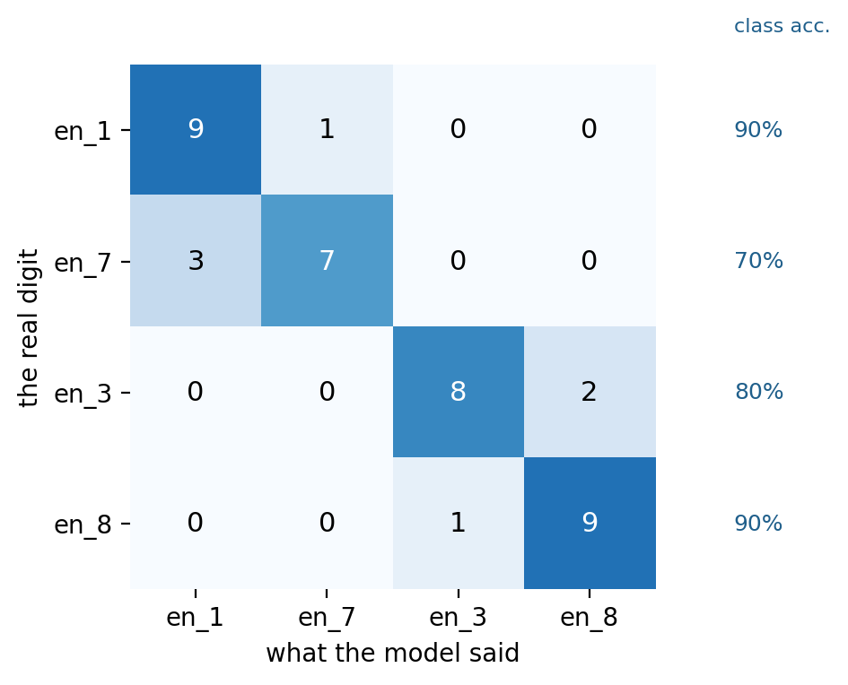
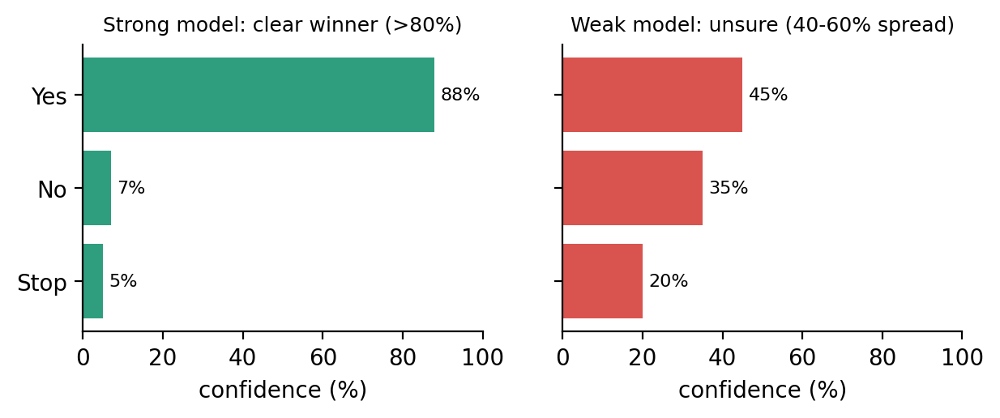

# Appendix E. Measuring Results

> **For curious readers.** Chapters 3, 7, 8 and 9 use total accuracy, class accuracy, confidence and the confusion matrix. This appendix walks through them with one small worked example. The numbers are made up by the author to show the method.

## E.1 Accuracy
**Accuracy** is the share of test samples the model got right:

accuracy = correct answers ÷ total test samples

If a model gets 27 of 30 test clips right, its accuracy is 27 ÷ 30 = 0.9, or **90%**.

## E.2 Why one number can hide problems
Imagine 30 test clips: 10 "yes", 10 "no", 10 "stop". The model's results:

| Class | Tested | Correct | Class accuracy |
|---|---|---|---|
| yes | 10 | 10 | 100% |
| no | 10 | 10 | 100% |
| stop | 10 | 7 | 70% |

The **total accuracy** is 27 ÷ 30 = 90%, which sounds great, but "stop" is weak. **Class accuracy** (accuracy for each class on its own) shows where to add samples. This is why the course asks you to read both.

## E.3 The confusion matrix
A **confusion matrix** is a table of *what the model said* against *what the sample really was*. As in Chapter 7, **rows are the real class** and **columns are the model's guess**.

| Real \ Guess | yes | no | stop |
|---|---|---|---|
| **yes** | 10 | 0 | 0 |
| **no** | 0 | 10 | 0 |
| **stop** | 1 | 2 | 7 |

- The **diagonal** (10, 10, 7) holds the correct answers. Big numbers there are good.
- Numbers **off the diagonal** are mistakes. Here "stop" was guessed as "yes" once and as "no" twice.
- Add each row to get the number tested; the diagonal divided by the row sum is the class accuracy.

Figure @fig:confusion-matrix-example-2 shows the confusion matrix from the Chapter 8 example.

{w=0.55}

**How to use it:** find the biggest off-diagonal number. That pair of classes is what to fix next, for example by adding more varied samples of both.

## E.4 Confidence
For each prediction, Teachable Machine shows a **confidence**: a percentage for every class that adds up to 100%. A strong model puts high confidence on the right class; a weak one spreads it out (Chapter 5). A high confidence is not a promise: a model can be confidently wrong, especially on things it never saw in training.

Figure @fig:confidence-strong-weak-2 compares a strong and a weak model (example values).

{w=0.8}

## E.5 Fair tests
Numbers are only trustworthy if the test is fair (Chapters 8 and 9):

- Test with **new** samples the model never trained on.
- Never augment test samples.
- Keep the test **balanced**: about the same number of samples in each class.
- Use the **same test** when comparing two models (Model A and Model B).
- Test with **different people, rooms and lighting**, not only yourself.

## E.6 Try it
1. A model scores 8 of 10 on "cat", 10 of 10 on "dog" and 3 of 10 on "bird". Work out the total accuracy and the class accuracies. Which class needs help?
2. Fill in a 3 × 3 confusion matrix for your own classifier. What is its biggest mistake?
3. Why is it unfair to test a model on the same samples it trained on?
