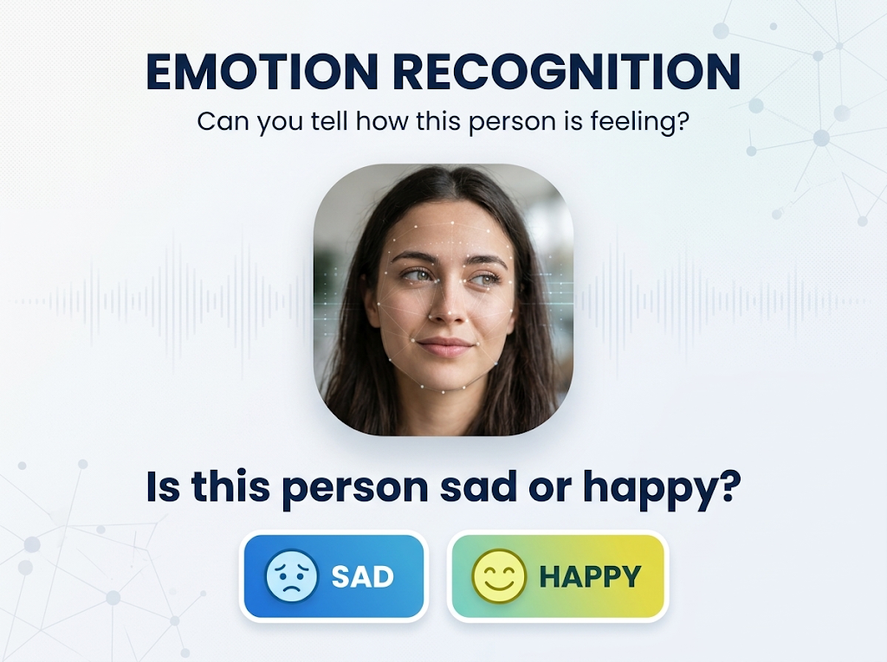
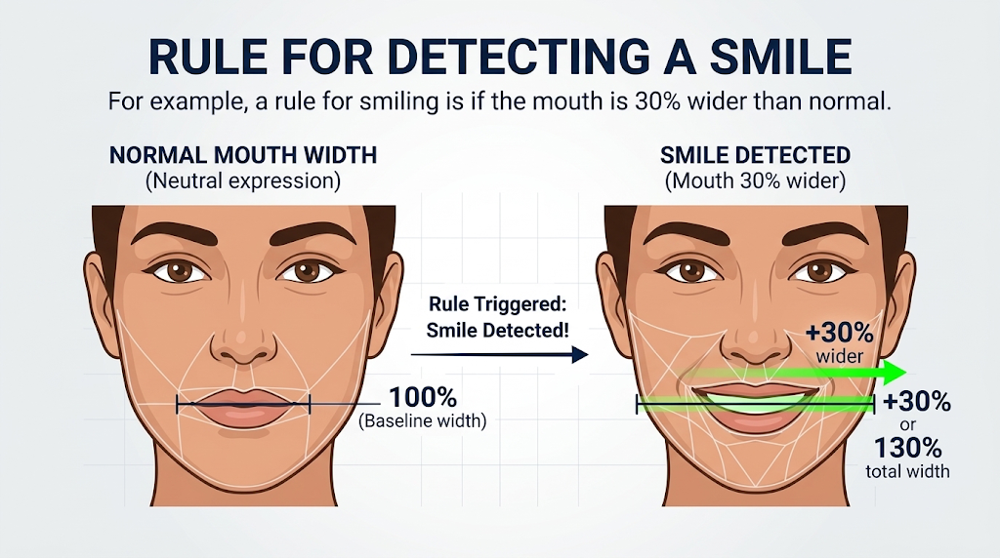
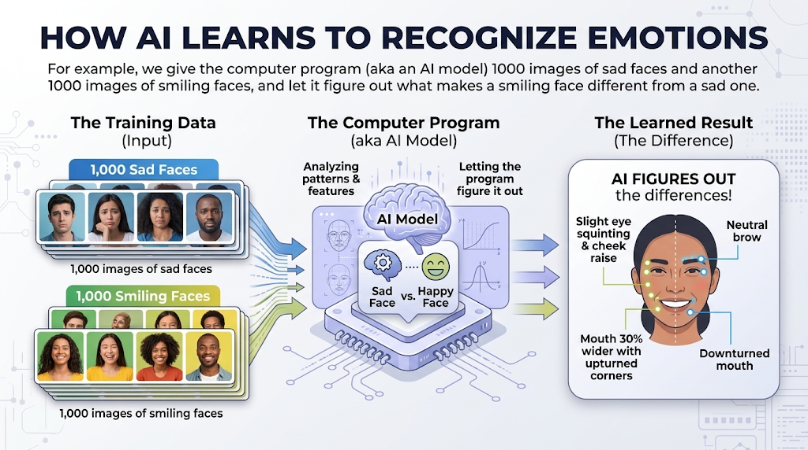
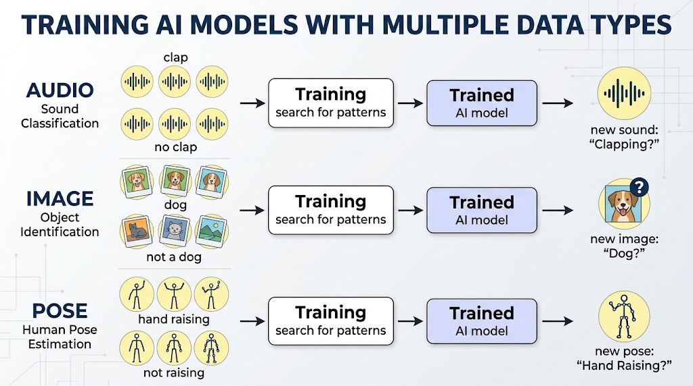
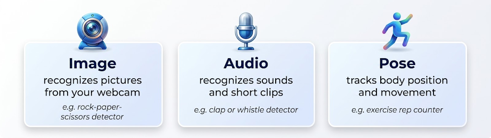

# Chapter 1. What Is Artificial Intelligence (AI), Really?

> **Chapter at a glance.** You will see how much of your day already runs on AI, learn what AI actually is, and meet the idea that powers every project in this book: a computer can *learn from examples* instead of being told exact rules. You finish by opening Google Teachable Machine, the free, no-code tool you will use all the way through.

## Learning objectives

By the end of this chapter you can:

1. Give everyday examples of AI and explain what each one learns.
2. Explain the difference between giving a computer rules and showing it examples.
3. Describe supervised learning as *data → labels → model → prediction*.
4. Name the three kinds of project in Teachable Machine (Image, Audio, Pose) and say what each one recognizes.
5. Open a blank Image Project and find the Class boxes, the webcam button, the Train Model button and the Preview panel.

## Key terms

**Artificial intelligence (AI)** · **model** · **training** · **data** · **label** · **prediction** · **supervised learning** · **pattern** · **Teachable Machine** · **class**

## 1.1 AI is already around you

Think about your day so far. Did you use a face filter on Instagram or Facebook? Watch a "For You" feed on TikTok or YouTube? Ask a voice assistant such as Siri (iPhone) or Google Assistant (Android) a question, listen to music suggested by Spotify or YouTube Music, unlock your phone with Face ID, or let autocorrect fix a typing mistake?

Every one of these runs on AI. Each also *learned* something to do its job:

| What you used    | What it learned        |
| ---------------- | ---------------------- |
| Face filters     | what a face looks like |
| Recommendations  | what you like to watch |
| Voice assistants | to understand speech   |
| Spam filters     | what spam looks like   |
| Music discovery  | your taste in music    |
| Autocorrect      | how you usually type   |

**Activity (icebreaker).** Tick the ones you have used today. Which surprised you? The rest of this chapter explains how such systems learn.

## 1.2 What is AI?

**Artificial Intelligence (AI)** means making a computer program (or a *model*) as smart as a human at some task. Take a simple question: *is this person sad or happy by looking at a face image?* You can tell at a glance. Does a computer know? Not unless it has been taught.

Figure @fig:emotion-recognition shows the question again: is this person sad or happy?

{w=0.6}

> **Note.** Recently, artificial intelligence has also been called **superintelligence**, especially when people talk about AI that could become smarter than humans rather than only as smart as a human at one task. This is the instructor's note and is not on the Week 1 slides.

## 1.3 Two ways to "program" a computer

**Way 1: step-by-step instructions.** A person writes exact rules and the computer follows them precisely. The same rules always give the same result. But the program breaks on cases nobody wrote a rule for. For example, a rule for smiling is if the mouth is 30% wider than normal.

Figure @fig:smile-rule shows the smile rule in action: the mouth is 30% wider than normal, so the rule says "smile detected".

{w=0.85}

**Way 2: AI.** A person shows lots of *examples*. The computer finds the pattern itself. It "learns" instead of being told, and it can handle new, never-seen examples. Such modelling approaches are data-driven. For example, we give the computer program (aka an AI model) 1000 images of sad faces and another 1000 images of smiling faces, and let the computer program figure what makes a smiling face different a sad one.

In Figure @fig:ai-learns-emotions the model receives 1,000 sad faces and 1,000 smiling faces and works out the differences by itself.

{w=0.95}

> **Think about it.** Can a computer learn something without anyone telling it exactly what to do? Discuss with a partner for 60 seconds before reading on.

Why not just write rules? Imagine writing rules for "smiling". How wide must the mouth curve? What about different faces, lighting, and camera angles? There are far too many cases. Showing examples is much easier, and it is how Teachable Machine works.

## 1.4 Supervised learning: sorting candy

Imagine you hand a friend 100 candies already sorted into a "red" pile and a "blue" pile. After a while, they start sorting *new* candies correctly on their own. That is **supervised learning**. It has four steps:

1. **Data.** Show lots of labeled examples.
2. **Labels.** Each example comes with the correct answer.
3. **Model.** The AI studies the patterns.
4. **Prediction.** It guesses labels for new data it has never seen.

> **What does "supervised" mean?** To *supervise* is to watch over and guide, like a teacher checking homework. In supervised learning, a person (the supervisor) gives the computer the **correct answer, called a label,** for every training example. The model learns by comparing its guesses with those answers. If the examples came with no answers, the learning would be *unsupervised*. This definition is the author's explanation, not from the slides.

Figure @fig:supervised-flow summarizes the four steps.

**Worked example 1: cat or dog.** Show the model 100 photos labeled "cat" and 100 labeled "dog". It studies the differences, such as shapes, ears and patterns. Then you show it a brand-new photo. It answers with a *confidence*: "That's 92% likely a dog!"

**Worked example 2: a smile detector.**

- *Training*: give the computer faces that are smiling and faces that are not smiling, and let it search for what makes them different.
- *Result*: a **trained AI model**.
- *Prediction*: show it a new face and ask, "Smiling?"

The whole flow is: **data → training (searching for patterns) → trained model → prediction.**

Figure @fig:smile-detector applies the four steps to the smile detector.

## 1.5 More than pictures: other kinds of data

The same idea works for any data (technically called "modality") a computer can read:

- **Image**: an emotion detector that looks at faces.
- **Audio**: an emotion detector that listens to voices (happy, angry, surprised).
- **Pose**: a bad-vs-good posture detector that tracks the skeleton of a sitting person.
- **Text**: a polite-vs-impolite detector, or sentiment analysis that labels a review positive, neutral or negative.

The limit is your imagination.

Figure @fig:multiple-data-types shows that audio, image and pose all follow the same path from examples to a trained model.

{w=0.95}

## 1.6 Meet Teachable Machine

**Google Teachable Machine** (teachablemachine.withgoogle.com) is a free tool that lets *you* train a real AI model in minutes, right in your browser. Extra course materials and helper tools for Teachable Machine are collected on the course website.^[Course web app: https://seqmodelling.rinabuoy.com/teachable-machine/]

- **No coding required**: point, click and train.
- **Fast results**: a working model in minutes.
- **Uses your webcam and microphone**: you collect your own real data live.

It offers three ways to train an AI:

| Project type    | Recognizes                 | Example                      |
| --------------- | -------------------------- | ---------------------------- |
| **Image** | pictures from your webcam  | rock-paper-scissors detector |
| **Audio** | sounds and short clips     | clap or whistle detector     |
| **Pose**  | body position and movement | exercise rep counter         |

Figure @fig:project-types shows the three project types side by side.

{w=1.0}

**Discuss.** If you built an AI for your favourite hobby, would it need to *see*, *hear*, or track *movement*? Pick your hobby and your AI type.

## 1.7 Hands-on: your first look at Teachable Machine

**Activity 1: create your workspace.**

1. Go to teachablemachine.withgoogle.com.
2. Click **Get Started**. No account or sign-up is required to try it.
3. When the browser asks, allow camera and microphone access.

**Activity 2: explore real example projects.** Open two or three public example projects and try them live. Write down: What classes (categories) did the project use? How accurate did it seem when you tested it live? What surprised you, or fooled the model? *Tip:* try to trick the model on purpose. That is how you learn its limits.

**Activity 3: open your first Image Project.** Open a blank Image Project. Do **not** train anything yet. Just find:

- the **Class boxes** where you will add examples,
- the **webcam capture button**,
- the **Train Model** button,
- the live **Preview** panel on the right.

Figure @fig:tm-workspace is a simplified sketch of the workspace you should find.

**Activity 4: test previous models.** Try out two image models that were trained earlier. Open each link, allow the camera if asked, and test the model live:

- **Mask detector** (classes: *Mask*, *No Mask*, *Incorrect*): [https://teachablemachine.withgoogle.com/models/ZAcyiHFuR/](https://teachablemachine.withgoogle.com/models/ZAcyiHFuR/)
- **Rock-paper-scissors** (classes: *paper*, *scissor*, *rock*): [https://teachablemachine.withgoogle.com/models/sNgYIRRGr/](https://teachablemachine.withgoogle.com/models/sNgYIRRGr/)

For each model:

1. Test every class and write down how confident the model is.
2. Try to fool it. For the mask model, what happens with a hand over the mouth or a mask worn under the nose? For the rock-paper-scissors model, what happens with a different hand position, distance or lighting, or with no hand at all?
3. Which class is the hardest for it? What kinds of examples might have been missing from its training data?

**Exit ticket.** Sketch an idea for a 2–3 class image classifier that you will build next week. Ideas: hand gestures, fruit vs. vegetable, facial expressions, school objects.

## Summary

- AI is all around you, and each system learned its skill from examples.
- Rules break on cases nobody foresaw; learning from examples handles new cases.
- Supervised learning = data → labels → model → prediction; the model answers with a confidence.
- The same idea works for images, sounds, poses and text.
- Teachable Machine lets you train Image, Audio and Pose models without writing code.

## Check your understanding

1. Name three apps you used this week and what each one learned.
2. In your own words, what is the difference between a rule and an example?
3. In the smile detector, what are the *data*, the *labels* and the *prediction*?
4. Which Teachable Machine project type would you use for a clap detector? For a posture checker?

*Answer hints:* (3) data = face photos; labels = smiling / not smiling; prediction = the model's guess for a new face. (4) Audio; Pose.

## Further practice

Bring your classifier sketch to the next chapter. Write down the 2–3 classes you will use and where you could collect the pictures.

---

*Draft notes.* Built from two Week 1 decks (a lesson deck and a lecture deck). The lecture deck's stock photos and screenshots from other websites were not used; the figures are original diagrams (see `wiki/figures/FIGURES.md`). See the wiki pages `week-01-what-is-ai`, `deck-week1-what-is-ai`, `deck-week1-lecture`, `supervised-learning`, `teachable-machine`.

<!-- wiki-nav -->

## Related (wiki)

Next: [[week-02-image-classification]]

Concepts: [[supervised-learning]] · [[teachable-machine]]
