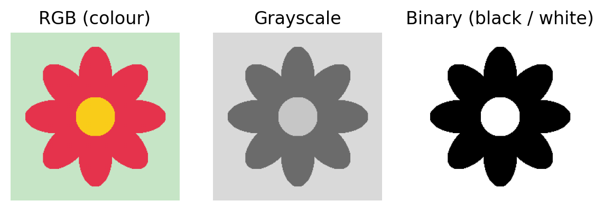
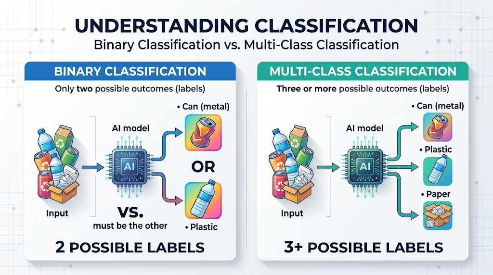
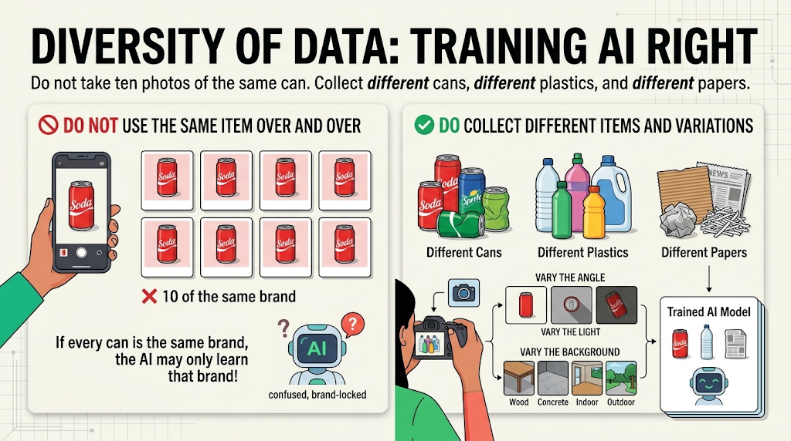

# Chapter 2. Image Classification

> **Chapter at a glance.** Before a computer can tell a can from a plastic bottle, you must understand what an image is and how to build a good set of examples. This chapter explains images, classification, and how to collect, store and test pictures, using a trash classifier as the running example.

## Learning objectives
By the end of this chapter you can:
1. Describe what an image is and name the common image types.
2. Explain image classification and tell binary from multi-class problems.
3. Identify the *input* and *output* of an image classifier.
4. Collect, diversify and store a dataset with one folder per class.
5. Describe how training data, a trained model and test data fit together.

## Key terms
**Image** · **RGB** · **grayscale** · **binary image** · **width and height** · **image classification** · **binary classification** · **multi-class classification** · **input** · **output (label)** · **dataset** · **diversity** · **training data** · **test data**

## 2.1 What is an image?
A digital **image** is a grid of tiny dots called pixels. Several types appear in this course and in real life:

- **RGB** images store **R**ed, **G**reen and **B**lue values for every pixel, giving full colour.
- **Grayscale** images keep only light and dark.
- **Binary** images have just two values, black and white.
- Special images include **X-rays** (medical scans of the chest, for example) and **satellite** photos (a city seen from above).

Figure @fig:flower-image-types shows the same flower as an RGB, a grayscale and a binary image.

{w=0.9}

**Image size** is described by **width** and **height**. Images can be small, medium or large. A bigger image holds more detail but takes more computing power. (In Chapter 7 you will see that Teachable Machine resizes every webcam frame to 224 × 224 pixels.)

> **Go deeper.** Want to know what a computer really stores for each pixel? See Appendix A, *How Computers See Pictures*.

## 2.2 What is image classification?
**Image classification** means giving an image a label. In this chapter the labels are kinds of rubbish:

- **Binary classification**: only two possible labels, for example *can (metal)* vs. *plastic*.
- **Multi-class classification**: three or more labels, for example *can (metal)* vs. *plastic* vs. *paper*.

Figure @fig:binary-vs-multiclass compares the two: with two labels the model must pick one or the other, while with three or more labels it picks one of several.

{w=0.95}

### The elements of a classifier
Every image classifier has the same two parts. For a **trash image classifier**:
- **Input**: an image.
- **Output**: a label (Plastic, Can or Paper).

Figure @fig:trash-classifier shows the input and output of the trash classifier.

### Why classify images?
Sorting rubbish for recycling is one reason; the same idea reaches medicine (X-rays), farming, traffic signs and satellites. **Think about it:** list other cases of image classification in your own community.

## 2.3 Collecting data
A model can only learn from what you show it, so data collection is the most important step.

### Where do pictures come from?
- a **camera**,
- a **mobile phone**,
- a **webcam**,
- **Google Image Search**.

### Diversity of data
Do not take ten photos of the same can. Collect *different* cans, *different* plastics and *different* papers. Vary the angle, the light and the background. If every can in your set is the same brand, the model may only learn that brand.

Figure @fig:diversity-of-data contrasts the two approaches: ten photos of the same can teach the model only one brand, while different items, angles, lighting and backgrounds teach it what a can, a plastic bottle and paper really look like.

{w=0.95}

### Storing your data
Keep one **folder per class**:
- `Can (metal)` folder
- `Plastic` folder
- `Paper` folder

Figure @fig:folder-structure shows how one folder per class keeps the dataset organized.

Putting a picture in the wrong folder gives the model a wrong lesson, so check carefully.

## 2.4 Training and testing with Teachable Machine
1. **Training data.** The folders of pictures go into [Google Teachable Machine](https://teachablemachine.withgoogle.com). Each folder becomes a class.
2. **Training.** Teachable Machine learns from the folders and produces the **trash classifier model**.
3. **Test data.** Show the model *new* pictures it has not seen. It answers CAN, PAPER or PLASTIC.

Always test with pictures that were not in the training folders, otherwise you are only checking its memory, not its learning.

**A trained model for reference.** A finished version of the trash classifier is online. Open it, allow the camera if asked, and test it with items from your own bag or classroom: [https://teachablemachine.withgoogle.com/models/2i97CAy5C/](https://teachablemachine.withgoogle.com/models/2i97CAy5C/). It is an Image model with three classes, *Plastic*, *Metal* and *Paper*. (Its "Metal" class plays the role of the "Can" class in this chapter.) Try the hard cases from Section 2.5 and see where it fails.

## 2.5 Hard test cases
Real life is messier than your training set. Good test pictures include a **dented can**, a **newspaper advertisement page** (paper, but colourful and full of text) and a **clear plastic item against a wall**. If the model struggles with these, add more varied examples of that class and train again. (Chapter 3 shows how.)

## 2.6 Practice time
Build the trash classifier, or the classifier you sketched in Chapter 1:
1. Decide on 2–3 classes.
2. Collect a varied set of pictures for each class.
3. Store each class in its own folder (or add them directly in Teachable Machine).
4. Train, then test with new pictures, including a few hard ones.

## Summary
- An image is a grid of pixels; common types are RGB, grayscale and binary.
- Classification gives an image a label; it is binary with two labels and multi-class with three or more.
- A classifier takes an image as input and outputs a label.
- Good data is varied, correctly labeled and stored one folder per class.
- Always test with pictures the model has never seen.

## Check your understanding
1. Is "cat / dog / rabbit" binary or multi-class? Why?
2. Name three ways to get pictures for a dataset.
3. Why is it a bad idea to take all your "can" photos of one brand?
4. Why should test pictures be different from training pictures?

*Answer hints:* (1) multi-class (three labels). (3) The model may learn the brand, not "can". (4) To measure learning, not memory.

## Further practice
Find a classification problem in your own community that could be solved with pictures. Write its input, its output labels and where you would collect the data.

---
*Draft notes.* Source deck is text-light; the examples above come from its slide titles and images. Its stock photos (X-ray, satellite, soda cans, bins and others) were not used; figures are original. See wiki pages `week-02-image-classification`, `deck-week2-image-classification`, `image-classification`, `dataset-quality`.

<!-- wiki-nav -->

## Related (wiki)
Previous: [[week-01-what-is-ai]] · Next: [[week-03-image-classification-project-lab]]

Concepts: [[image-classification]] · [[dataset-quality]]
