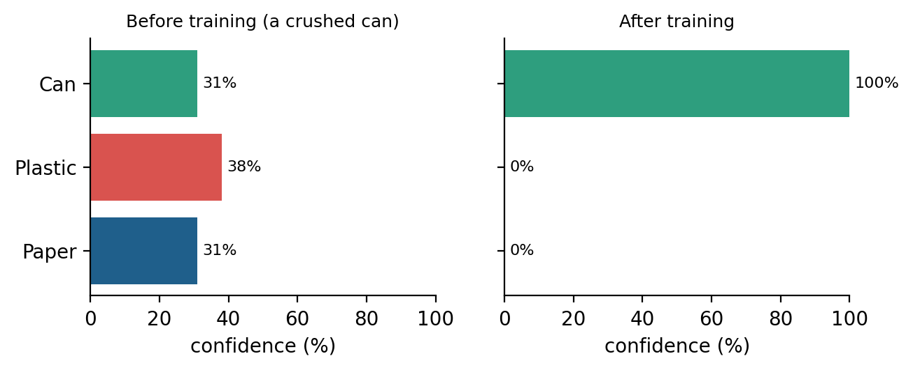
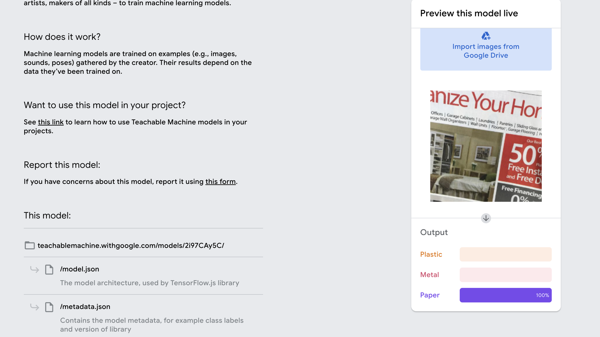

# Chapter 3. Image Classification Project Lab: Train, Tune, Save and Share

> **Chapter at a glance.** You have a dataset; now you will train a model, understand the three settings that control training, tune them by trying, and finally save and share your project. The lab ends with a project you present to friends.

## Learning objectives

By the end of this chapter you can:

1. Explain what happens during training and recognize an untrained vs. a trained model.
2. Describe **epochs**, **learning rate** and **batch size**, and what goes wrong when each is too low or too high.
3. Use a train → test → retry loop to improve a model, and explain why you test with new pictures.
4. Split your pictures into a training set and a test set.
5. Save a Teachable Machine project and share a model with a link.
6. Build and share a rock-paper-scissors or mask/no-mask classifier.

## Key terms

**Training** · **epoch** · **learning rate** · **batch size** · **overfitting (memorizing)** · **training set** · **test set** · **train-test split** · **Advanced settings** · **Preview** · **export** · **shareable link**

## 3.1 Recap

Last chapter you met image types (RGB, grayscale, binary), multi-class classification (can vs. plastic vs. paper), and the idea of **one folder per class** for storing examples. We now put those folders to work.

## 3.2 What training does

In Teachable Machine each class holds example images. The workspace shows, for example, three classes (**Can**, **Plastic**, **Paper**) with ten image samples each, and a **Train Model** button.

**Before training**, the model is guessing. Show it a picture and the Output bars are close to an even split, roughly a third for each class (the course screenshots show about 31–36% each). **After training**, the same kind of picture gets a confident answer. In the course examples a crushed red can went from about 31/38/31% to **100% Can**, a white plastic bottle neck scored **99% Plastic**, and crumpled paper scored **92% Paper**.

Training means the model looks at your examples over and over, getting better at *predicting the right output*.

Figure @fig:training-before-after shows example output bars before and after training.

{w=0.9}

## 3.3 Three questions about training

Training is controlled by three settings in the **Advanced** panel:

| Question                  | Setting                 | Teachable Machine default |
| ------------------------- | ----------------------- | ------------------------- |
| How long to train?        | **Epochs**        | 50                        |
| How large a step to take? | **Batch size**    | 16                        |
| How fast to learn?        | **Learning rate** | 0.001                     |

A **Reset Defaults** button restores them, and **Under the hood** shows accuracy per class and a confusion matrix (Chapter 7).

Figure @fig:advanced-panel shows the Advanced panel with its default values.

### Epochs: how long to train

An *epoch* is one full pass over all your samples.

- **Too low (1–5):** not enough time to learn.
- **Too high (100–1000):** the model *memorizes* your pictures instead of understanding them. This is called overfitting.
- **Solution:** find a good value by trying many times (technically called "tuning").

Figure @fig:epochs-effect illustrates what too few and too many epochs do.

{w=0.7}

### Learning rate: how fast to learn

The learning rate is how big each adjustment to the model is.

- **Too small** (for example 0.000001): learning crawls.
- **Too large** (for example 1): the model overshoots and never settles.
- **Solution:** again, try values and test.

### Batch size: how many samples at a time

The batch size is how many samples the model looks at in each step. Examples shown are 1 and 10. The right choice depends on **your computer's computing power**.

> **Go deeper.** Curious what happens inside the model during training? See Appendix C, *How a Model Learns*.

> **Teaching note.** The slides picture hand-washing laundry next to a washing machine for this idea; read it as "a few items at a time versus many at once".

## 3.4 The tuning loop

No single setting is right for every project. Use this loop:

1. **Try some settings.**
2. **Test the model** with new pictures.
3. **Not OK?** Change a setting (or add better data) and go back to step 1.
4. **OK?** Done.

Figure @fig:tuning-loop shows the tuning loop.

### Why not test on the training pictures?
Testing with the same pictures the model trained on is like giving students 100 practice questions to prepare for an exam, and then putting exactly the same 100 questions in the exam. A student who scores 100% might truly understand the subject, or might simply have **memorized** the answers. From the scores alone, you cannot tell which.

A model is the same. Pictures it has already seen will almost always get a high score, even if the model has only memorized them (this is the overfitting from the epochs section). To find out whether it has really **learned** the idea of a can, a plastic bottle or a hand gesture, test it with **new pictures** it has never seen, like fresh exam questions. *(The exam comparison is the author's analogy.)*

Testing must use pictures the model has not seen. Compare which hard cases fail, such as a newspaper ad or a clear plastic item, and add varied examples of those classes.

## 3.5 Train-test split
Section 3.4 said to test with pictures the model has never seen. The easiest way to get such pictures is a **train-test split**: before you train, divide your pictures for each class into two groups.

- The **training set** is what the model learns from.
- The **test set** is kept aside. The model never sees it while learning, and you use it **only** to check the result, like the real exam.

A common choice is about **80% for training and 20% for testing**. (This is general practice, not from the slides.) For example, if you have 50 pictures of plastic bottles, put 40 in the training set and keep 10 for testing. Do the same for every class.

Figure @fig:train-test-split shows the split.

**Rules for a fair split**

1. **Split first, then train.** Set the test pictures aside *before* you press Train Model, and never add them to a class.
2. **Keep the test set untouched.** If a test picture fails, do not copy it into the training set and then re-test with the same picture; take new pictures for the next round of testing.
3. **Mix the split.** Do not use only the first photos you took for training and the last ones for testing. Pick at random, so both groups contain a mix of angles, light and backgrounds.
4. **Test every class.** Keep some test pictures for each class, in roughly equal numbers.
5. **Use other people if you can.** A friend's photos or handwriting make a tougher, more honest test than your own.

**How to do it in Teachable Machine.** Keep your test pictures in a separate folder on your computer and do not upload them to any class. After training, test by showing them to the Preview (webcam or *Upload*). Teachable Machine also reports accuracy on its own held-out samples: open **Advanced → Under the hood** (see Chapter 7). *(Author's note: Teachable Machine's built-in split is not described in the slides; check the exact percentages in the tool before quoting them.)*

Later chapters build on this idea: in Chapter 7 you test with labelled folders of fresh pictures, and in Chapters 8 and 9 you must never augment the test set.

## 3.6 Saving your project

Saving keeps your work for later. Teachable Machine lets you save **online** (to Google Drive, or as a shareable link) or **on your computer** (download the project file). Open the project menu (top left) to find *Save project to Drive* and *Download project as file*. A model link alone cannot be retrained, so save the project itself if you want to add more images.

## 3.7 Sharing your project

Sharing lets anyone try your model.

1. Click **Export Model**.
2. Choose **Upload (shareable link)**. The export panel also lists TensorFlow.js, TensorFlow and TensorFlow Lite options.
3. Copy the link (it looks like `teachablemachine.withgoogle.com/models/…`).

Anyone with the link can use the model on their own webcam, so share it with care.

Figure @fig:shared-model-page shows the page that opens from a shared link: the model's web address and files on the left, and a live preview on the right where anyone can test the model (here with a picture of a newspaper advertisement, which the model labels Paper).

{w=0.95}

## 3.8 Your turn: project lab

Train **either** a rock-paper-scissors **or** a mask / no-mask model:

1. Create 3 (or 2) classes and collect varied images for each. Keep about 20% of the pictures aside as a test set.
2. Train with the default settings and test.
3. Tune: try changing epochs, then learning rate or batch size, one at a time.
4. Test with your test set, then with new people and backgrounds.
5. Save the project and share your model link with your instructor or friends.

## Summary

- Training makes the model better at predicting the right output; untrained outputs are close to even guesses.
- Epochs, learning rate and batch size control how long, how fast and how big a step; too much or too little of each causes problems.
- Improve by looping: try, test, adjust.
- Split your pictures into a training set (about 80%) and a test set (about 20%) before you train, and keep the test set untouched.
- Test with new pictures, never the training ones: like an exam that repeats the practice questions, a test on training pictures cannot tell understanding from memorizing.
- Save the project to keep working; share with an exported link.

## Check your understanding

1. What do the Output bars look like before training?
2. What does a *very high* number of epochs risk?
3. Why change only one setting at a time?
4. What is the difference between saving a project and sharing a model link?

*Answer hints:* (1) near-equal bars. (2) Memorizing instead of understanding. (3) So you know which change caused the result. (4) A project can be retrained; a link only runs the model.

## Further practice

Record the settings and accuracy for each experiment in a small table, then explain which setting made the biggest difference.

---

*Draft notes.* Slide screenshots of Google's interface and the watermarked emoji illustrations were not used; the figures are original sketches and charts (see `wiki/figures/FIGURES.md`). See wiki pages `week-03-image-classification-project-lab`, `deck-week3-image-classification-project-lab`, `training-settings`, `overfitting`.

<!-- wiki-nav -->

## Related (wiki)

Previous: [[week-02-image-classification]] · Next: [[week-04-audio-sound-classification]]

Concepts: [[training-settings]] · [[overfitting]] · [[evaluation-accuracy]]
